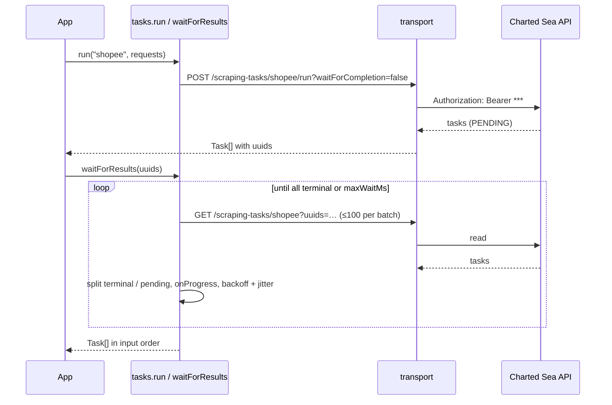

# Architecture

Built (0.2.0). Every module below exists and is covered by tests at 100% per file.

## Modules

```
src/
  index.ts            public exports only
  client.ts           createClient: resolves config, wires modules together
  config.ts           option parsing and defaults (pure)
  http/
    transport.ts      fetch wrapper: auth header, timeout, AbortSignal, JSON, error mapping
    retry.ts          backoff with full jitter; Retry-After; idempotent calls only (pure)
    redact.ts         token and proxy-credential redaction (pure)
  resources/
    tasks.ts          run, runSingle, read, iterate, count, cancel
    health.ts         sessionMetrics, taskMetrics
    proxies.ts        validate, read, update
  polling/
    wait.ts           waitForResults state machine
    status.ts         terminal-status table (pure)
    batch.ts          UUID chunking and order-preserving merge (pure)
  proxy-url/
    parse.ts          ${rand(...)} / ${country(...)} placeholder parser (pure)
  decode.ts           lenient response decoders (keep unknown fields; accept both read shapes)
  timers.ts           abortable sleep
  errors.ts           ChartedSeaError hierarchy
  types.ts            API types
```

## Dependency rules

Enforced by dependency-cruiser (`npm run check:deps`).

- `resources/*` depend on `http/transport` through an injected interface, never on `fetch` directly.
- `polling/*` depends on `resources/tasks` through an interface, so it's tested with a fake reader and fake timers.
- Pure modules (`config`, `retry`, `redact`, `status`, `batch`, `proxy-url`) import nothing with I/O.
- Nothing imports `index.ts` except consumers.

## Request flow



## Cross-cutting

- **Time and randomness** are injected (`now`, `sleep`, `random`) so polling and backoff are deterministic in tests.
- **Redaction** happens in one place (`http/redact.ts`), before anything reaches an error, a log or `cause`.
- **Forward compatibility:** unknown response fields are preserved; unknown statuses are non-terminal.
- **Runtime:** only `fetch`, `AbortController`, `URL` and `setTimeout`, so it runs on Node 22+, Bun and Deno.
